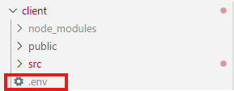
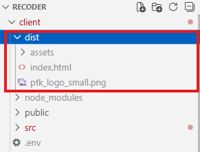
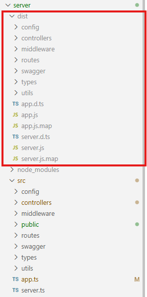
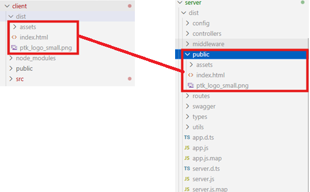
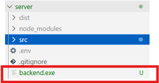

# **Recoder 프론트엔드·백엔드 통합 실행 프로그램 생성 가이드**

## 1. 패키지 설치

```
npm install pkg
npm install bcryptjs
```
<small>※만약 안되는 경우 핫스팟으로 연결 후 cato를 끈 상태에서(회사인터넷만 아니면 됨) 다시 시도</small>

## 2. 프론트 빌드
### 2.1 env 파일 수정



  **VITE_API = <span style="color:red">`https://localhost:5000`</span>**
        
 -> 
  
  **VITE_API = <span style="color:green">`/api`</span>**
  
  변경
### 2.2 빌드
```
cd client
npm run build
```



dist 파일 생성

## 3. 백엔드 빌드

### 3.1 빌드 전 코드 수정

**server\src\controllers\auth\authController.ts** 코드 수정

**import <span style="color:red">bcrypt from 'bcrypt';</span>**
        
 -> 
  
**import <span style="color:green">\* as bcrypt from 'bcryptjs';</span>**

<sub>※ 참고 bcrypt 는 node파일을 사용하고 이후 exe 로 빌드하는 과정에서 사용하는 pkg는 파일들을 js로 패키징화 해서 사용하기 때문에 bcrypt 가 아닌 bcryptjs를 사용해야함</sub>

### 3.2 빌드
```
cd server
npx tsc
```



dist 파일 생성

## 4. 통합 실행파일 빌드

### 4.1 백엔드 프론트 폴더 통합

1. 백엔드 빌드 폴더(dist)에 public 폴더 생성
2. public 폴더에 프론트 빌드 결과물 이동



### 4.2 코드 수정
**server\src\app.ts** 수정

<span style="background-color: #e6ffed;">import path from 'path';</span>
<small><span style="color:green">\# import 추가 </span></small>

console.log(`📘 Swagger 문서 👉 http://localhost:${process.env.PORT}/api-docs`);

<span style="background-color: #e6ffed;">
const publicPath = path.join(__dirname, 'public');<br>
app.use(express.static(publicPath));<br>
app.get('*', (req, res) => {<br>
  res.sendFile(path.join(publicPath, 'index.html'));<br>
</span>
<small><span style="color:green"># 코드 추가</span></small>

### 4.3 package.json 파일 수정
```
Package.json -> 
{
 "bin": "dist/server.js",
 "pkg": {
 "assets": [
 "dist/public/**/*"
 ]
 }
}
```

추가<br>
<small><span style="color:red">#만약 env 파일까지 합쳐서 실행파일화 하고 싶다면 assets 내부에 .env 추가</span></small>

## 5. 실행파일 생성


```
cd server
pkg . -t node18-win-x64
```
폴더 내 exe 파일 생성


server 폴더 내 
.env 파일 설정

```
DB_HOST= # 데이터베이스 호스트
DB_PORT= # 데이터베이스 포트
DB_USER= # 데이터베이스 사용자 계정 ID
DB_PASSWORD= # 데이터베이스 사용자 계정 PW
DB_NAME= # 연결할 데이터베이스 이름 (실제 배포된 db 이름은 다를수도 있어 확인 필요)
PORT=5000 # 서버 포트
```
<small>* 만약 assets 내부에 env 파일을 추가하지않았다면 *</small>

**서버와 연결된 .env 설정 후 같은폴더에서 실행**
**env 파일 값은 직접 설정해줘야 함.**
